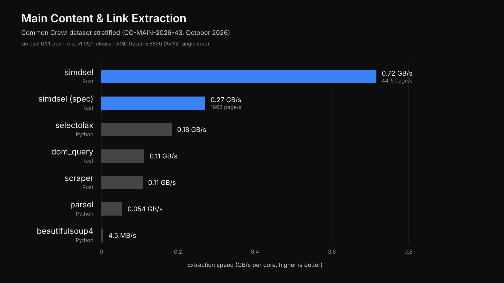

# simdhtml

A SIMD-accelerated HTML parser and CSS/XPath selector.

- Rust crates: [`simdhtml`](./crates/simdhtml) (parser) and
  [`simdsel`](./crates/simdsel) (selection).
- Python binding: [`simdsel-py`](./crates/simdsel-py).

## Performance

The figures show extraction speed on real pages, single core on an AMD Ryzen
5 5600.

[](./figures/cc.svg)

[](./figures/swde.svg)

## Usage

### Python

```python
>>> from simdsel import Selector
>>> html = """
... <div class="item" data-id="1"><h2>First &amp; best</h2><a href="/one">one</a></div>
... <div class="item" data-id="2"><h2>Second</h2><a href="/two">two</a></div>
... """
>>> sel = Selector(text=html)
>>> sel.css(".item h2::text").getall()
['First & best', 'Second']
>>> sel.css(".item h2::text").get()
'First & best'
>>> sel.css(".item a::attr(href)").getall()
['/one', '/two']
>>> sel.xpath("//div[@data-id='2']/h2/text()").get()
'Second'
>>> [item.attrib["data-id"] for item in sel.css(".item")]
['1', '2']
```

### Rust

```rust
use simdsel::prelude::{Selector, Value, XPath};

fn main() -> Result<(), Box<dyn std::error::Error>> {
    let html = r#"
<div class="item" data-id="1"><h2>First &amp; best</h2><a href="/one">one</a></div>
<div class="item" data-id="2"><h2>Second</h2><a href="/two">two</a></div>
"#;

    let root = Selector::from_text(html)?;
    println!("{:?}", root.css(".item h2::text")?.getall());
    println!("{:?}", root.css(".item a::attr(href)")?.getall());

    if let Value::Str(id) = XPath::new("string(//div[2]/@data-id)")?.eval(root.doc())? {
        println!("id={id}");
    }
    Ok(())
}
```

## Development

```bash
cargo test                 # Rust tests
cargo xtask compat --parsel  # parsel compatibility tests
cargo xtask data           # fetch inputs and build the SWDE working set
cargo xtask data --clear   # remove downloaded/derived data
cargo xtask bench --quick  # sampled benchmark
cargo xtask bench --compare
cargo xtask plot           # figures/cc.svg, figures/swde.svg
```

More commands: `cargo xtask --help`. Data layout: [`data/README.md`](./data/README.md).
