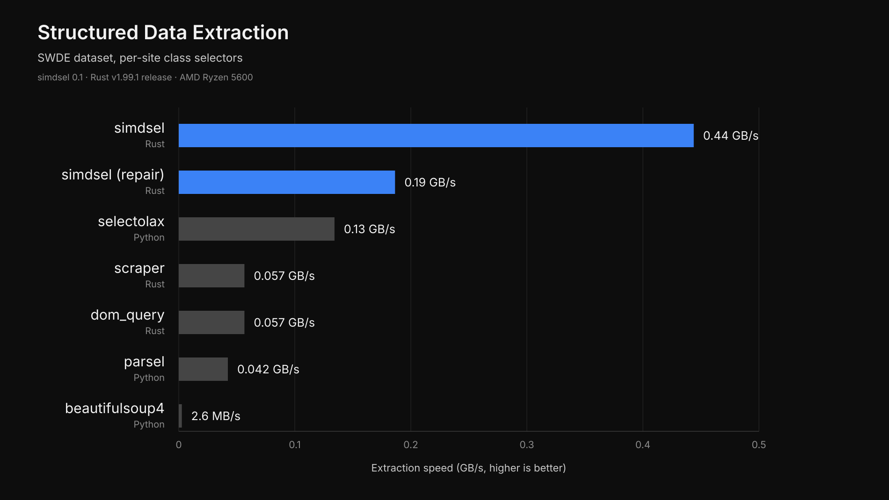

# simdhtml

A SIMD-accelerated HTML parser and CSS selector.

- Rust crates: [`simdhtml`](./crates/simdhtml) (parser) and
  [`simdsel`](./crates/simdsel) (CSS/XPath selection).
- Python binding: [`simdsel-py`](./crates/simdsel-py).

## Performance results

The following figures show how fast simdhtml extracts data from HTML. The task is to extract main content from most webpages and extract structured data from specified sites. The bench currently runs on an AMD Ryzen 5600 processor with single core. You can reproduce the result on your device with `./x bench`.

[](./figures/main-content-and-link-extraction.svg)

[](./figures/structured-data-extraction.svg)

We also reached 98% HTML compliance in `RepairMode::Spec`, which is the
`simdsel (spec mode)`.

## Usage

### Python

```python
from simdsel import Selector

html = """<div class="item" data-id="1"><h2>First &amp; best</h2><a href="/one">one</a></div>
<div class="item" data-id="2"><h2>Second</h2><a href="/two">two</a></div>"""

sel = Selector(text=html)

print(sel.css(".item h2::text").getall())       # ['First & best', 'Second']
print(sel.css(".item h2::text").get())          # 'First & best'
print(sel.css(".item a::attr(href)").getall())  # ['/one', '/two']
print(sel.xpath("//div[@data-id='2']/h2/text()").get())  # 'Second'

for item in sel.css(".item"):
    print(item.attrib["data-id"], item.css("h2::text").get())
```

### Rust

```rust
use simdsel::{Selector, Value, XPath};

fn main() -> Result<(), Box<dyn std::error::Error>> {
    let html = r#"<div class="item" data-id="1"><h2>First &amp; best</h2><a href="/one">one</a></div>
<div class="item" data-id="2"><h2>Second</h2><a href="/two">two</a></div>"#;

    let root = Selector::from_text(html)?;      // or from_vec(body) for owned bytes

    let titles = root.css(".item h2::text")?;
    println!("{:?}", titles.getall());          // ["First & best", "Second"]
    println!("{:?}", titles.get());             // Some("First & best")

    let links = root.css(".item a::attr(href)")?;
    println!("{:?}", links.getall());           // ["/one", "/two"]

    for record in root.css(".item")?.records() {
        println!("{:?}", simdsel::record_attrib(root.doc(), record));
    }

    if let Value::Str(id) = XPath::new("string(//div[2]/@data-id)")?.eval(root.doc())? {
        println!("id={id}");                    // id=2
    }

    Ok(())
}
```


## Development

```bash
./x data          # download/extract Common Crawl WARC, prepare SWDE + manifests
./x test          # Rust tests + PyO3 binding smoke test
./x test-wpt      # WPT tree-construction conformance
./x test-corpus   # Common Crawl preorder-invariant test
./x bench         # full Criterion run: simdhtml/simdsel + html5ever/scraper/dom_query + Python
./x bench-quick   # smaller/faster run for iteration
./x check         # cargo fmt --check + cargo clippy
./x bundle        # portable tarball: binaries + data + Python runtime
```

`./x bundle` builds a `.tar.zst` (falls back to `.tar.gz`) with the prebuilt
bench binaries, a sampled data tree, the uv site-packages, and a portable
CPython runtime.  Unpack it on the target machine and run `./x bench`; no build
or network is needed.

```bash
./x bundle                              # sample data (500 CC + 500 SWDE docs)
./x bundle --data full --with-warc      # full corpora
./x bundle --data none                  # binaries/Python only
./x bundle --cc-docs 100 --swde-docs 100
./x bundle --format gz
```
