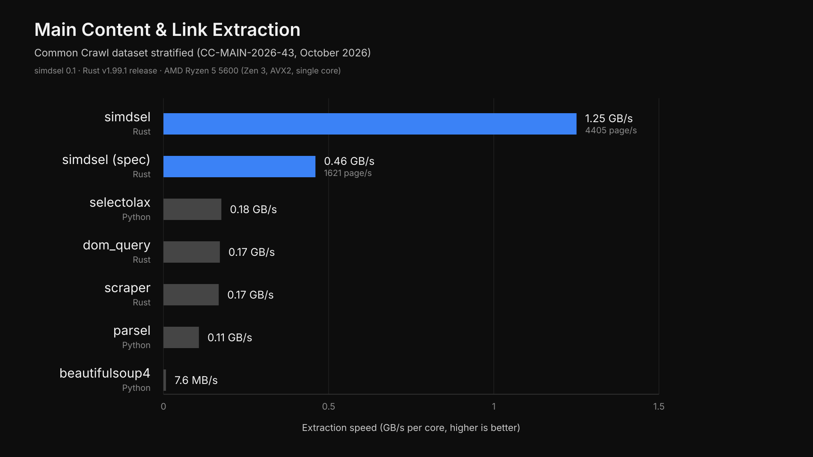

# simdhtml

A SIMD-accelerated HTML parser and CSS selector.

- Rust crates: [`simdhtml`](./crates/simdhtml) (parser) and
  [`simdsel`](./crates/simdsel) (CSS/XPath selection).
- Python binding: [`simdsel-py`](./crates/simdsel-py).

## Performance results

The following figures show how fast simdhtml extracts data from HTML. The task is to extract main content from most webpages and extract structured data from specified sites. The bench currently runs on an AMD Ryzen 5600 processor with single core. You can reproduce the result on your device with `make bench`.

[](./figures/main-content-and-link-extraction.svg)

[](./figures/structured-data-extraction.svg)

We also reached 98% HTML compliance in `RepairMode::Spec`, which is the
`simdsel (repair)` row.

## Usage

### Python

```python
>>> from simdsel import Selector
>>> html = """
... <div class="item" data-id="1"><h2>First &amp; best</h2><a href="/one">one</a></div>
... <div class="item" data-id="2"><h2>Second</h2><a href="/two">two</a></div>
... """
>>> sel = Selector(text=html)
>>> sel.css(".item h2::text").getall()
['First & best', 'Second']
>>> sel.css(".item h2::text").get()
'First & best'
>>> sel.css(".item a::attr(href)").getall()
['/one', '/two']
>>> sel.xpath("//div[@data-id='2']/h2/text()").get()
'Second'
>>> [item.attrib["data-id"] for item in sel.css(".item")]
['1', '2']
>>> [item.css("h2::text").get() for item in sel.css(".item")]
['First & best', 'Second']
```

### Rust

```rust
use simdsel::{Selector, Value, XPath};

fn main() -> Result<(), Box<dyn std::error::Error>> {
    let html = r#"
<div class="item" data-id="1"><h2>First &amp; best</h2><a href="/one">one</a></div>
<div class="item" data-id="2"><h2>Second</h2><a href="/two">two</a></div>
"#;

    let root = Selector::from_text(html)?;      // or from_vec(body) for owned bytes

    let titles = root.css(".item h2::text")?;
    println!("{:?}", titles.getall());          // ["First & best", "Second"]
    println!("{:?}", titles.get());             // Some("First & best")

    let links = root.css(".item a::attr(href)")?;
    println!("{:?}", links.getall());           // ["/one", "/two"]

    let items = root.css(".item")?;
    for item in items.split() {
        println!("{:?}", item.attrib());        // Some([("data-id", "1")])
        println!("{:?}", item.css("h2::text")?.get()); // Some("First & best")
    }

    if let Value::Str(id) = XPath::new("string(//div[2]/@data-id)")?.eval(root.doc())? {
        println!("id={id}");                    // id=2
    }

    Ok(())
}
```


## Development

`make` is the only entry point; `make` alone lists the targets.

```bash
make data          # fetch raw inputs: Common Crawl WARC + SWDE submodule (once)
make extract-data  # unpack SWDE and build its index (once, ~1 min, 8 GiB disk)
make test          # Rust tests
make test-wpt      # html5lib tree-construction conformance
make test-corpus   # Common Crawl preorder-invariant test
make bench-build   # build the bench executables into target/bench/bin (cargo, once)
make bench-compare # scoreboard: extract + python_compare, 60 documents (figures/*.svg)
make bench         # full criterion run of every bench target
make bench-quick   # sampled run for iteration (no plots)
make venv          # .venv with parsel/selectolax/bs4, via pip (default PyPI)
make venv-cn       # same, from the Tsinghua mirror
make venv-ali      # same, from the Aliyun mirror
make check         # cargo fmt --check + cargo clippy
make info          # data, venv, bench binaries and the targets that run
```

