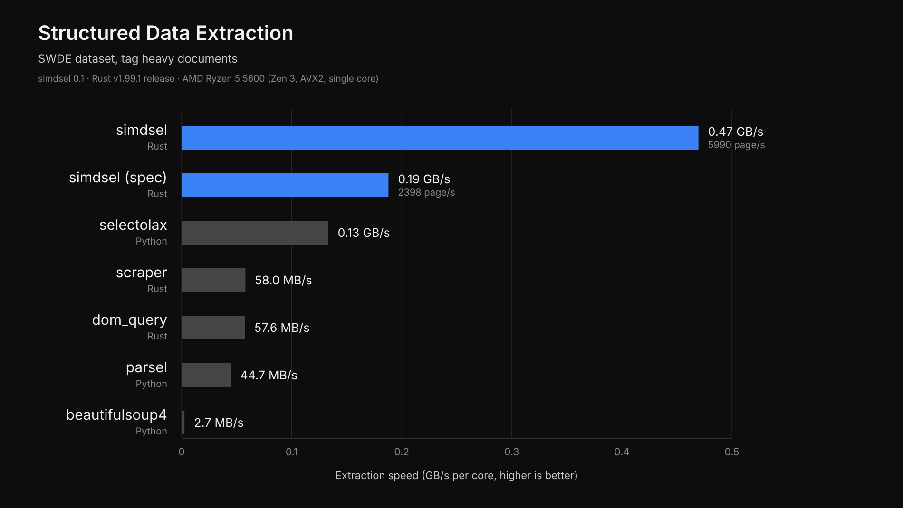

# simdhtml

**A gigabytes fast HTML parser and selector, powered by Rust and SIMD.**

Parsing has been a huge bottleneck for large-scale web crawlers. simdhtml brings native SIMD speed to the HTML extraction pipeline—10x faster than parsel, the scrapy default.

- **Fast**: Over 4000 pages/s/core in real-world workloads, 7x-150x faster than commonly used parsers.
- **Drop-in Replacement**: Migrate from parsel by changing a single line of code.
- **Standards**: 98% WPT conformance in spec mode, while remaining significantly faster.
- **Automatic**: Adapt to available CPU features at runtime. No configuration needed.
- **Reliable**: Built in Rust, with `unsafe` strictly confined to low-level SIMD intrinsics.

[](https://pypi.org/project/simdsel/)
[](https://crates.io/crates/simdhtml)
[](https://crates.io/crates/simdsel)
[](https://github.com/xbwwj/simdhtml/actions/workflows/ci.yml)
[](#license)

**[Documentation(Python)](#)** · **[Documentation(Rust)](https://docs.rs/simdsel)** · [Installation](https://pypi.org/project/simdsel/) · [Usage](#usage) · [Benchmarks](#benchmarks)

## Benchmarks

[](./figures/cc.svg)

[](./figures/swde.svg)

## Usage

### Python

```python
>>> from simdsel.parsel import Selector
>>> html = """
... <div class="item" data-id="1"><h2>First &amp; best</h2><a href="/one">one</a></div>
... <div class="item" data-id="2"><h2>Second</h2><a href="/two">two</a></div>
... """
>>> sel = Selector(text=html)
>>> sel.css(".item h2::text").getall()
['First & best', 'Second']
>>> sel.css(".item h2::text").get()
'First & best'
>>> sel.css(".item a::attr(href)").getall()
['/one', '/two']
>>> sel.xpath("//div[@data-id='2']/h2/text()").get()
'Second'
>>> [item.attrib["data-id"] for item in sel.css(".item")]
['1', '2']
```

### Rust

```rust
use simdsel::prelude::{Selector, Value, XPath};

fn main() -> Result<(), Box<dyn std::error::Error>> {
    let html = r#"
<div class="item" data-id="1"><h2>First &amp; best</h2><a href="/one">one</a></div>
<div class="item" data-id="2"><h2>Second</h2><a href="/two">two</a></div>
"#;

    let root = Selector::from_text(html)?;
    println!("{:?}", root.css(".item h2::text")?.getall());
    println!("{:?}", root.css(".item a::attr(href)")?.getall());

    if let Value::Str(id) = XPath::new("string(//div[2]/@data-id)")?.eval(root.doc())? {
        println!("id={id}");
    }
    Ok(())
}
```

## Development

We use xtask for automating chores.

```bash
# test parsel compatbility
cargo xtask compat --parsel

# data management
cargo xtask data          
cargo xtask data --clear

# corpus tests (need `cargo xtask data`)
cargo test --release -p simdhtml-tests -- --ignored
cargo test -p simdhtml-tests --features quick -- --ignored

# sampled benchmark for fast iteration
cargo xtask bench --quick

# benchmark compared with other parsers
cargo xtask bench --compare

# plot performance graph
cargo xtask plot
```

## Roadmap

- More bindings: JS/C/CLI/Go
- Query aware parser: do not pay for unnecessary parsing
- Mutable support: so that we can support bs4 and dom like api
- GPU: large scale, offline analysis, but not of priority

## Credits

- [`simdjson`](https://github.com/simdjson/simdjson)
- [`cuJSON`](https://github.com/AutomataLab/cuJSON)
- [`algorithmica`](https://github.com/algorithmica-org/algorithmica)
- [`html5ever`](https://github.com/servo/html5ever)
- [`parsel`](https://github.com/scrapy/parsel)

## License

[MIT](./LICENSE-MIT) or [Apache 2.0](./LICENSE-APACHE) at your option.
