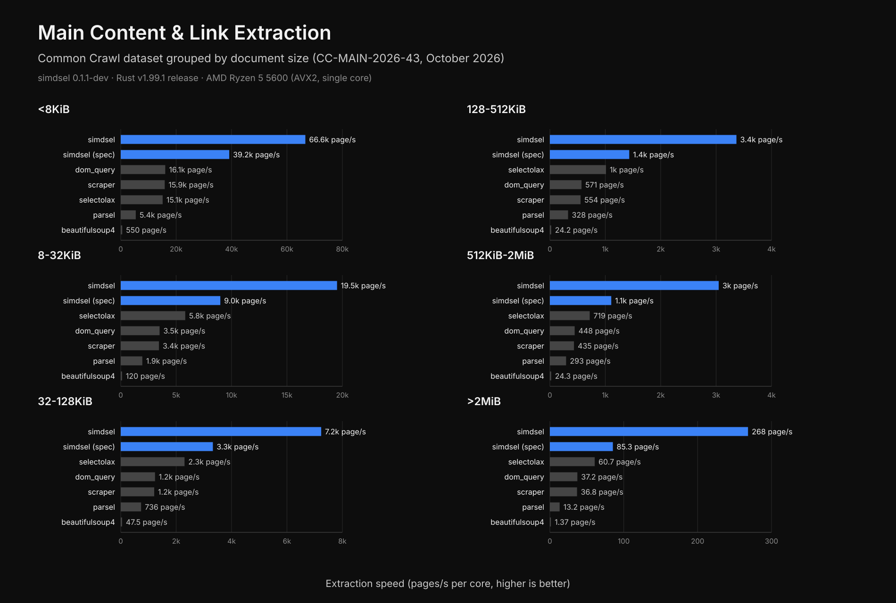

# simdhtml

**A gigabytes fast HTML parser and selector, powered by Rust and SIMD.**

Parsing has been a huge bottleneck for large-scale web crawlers. simdhtml brings native SIMD speed to the HTML extraction pipeline—10x faster than parsel, the scrapy default.

- **Fast**: Over 4000 page/s/core in real-world workloads, 7x-150x faster than commonly used parsers.
- **Drop-in Replacement**: Migrate from parsel by changing a single line of code.
- **Standards**: 98% WPT conformance in spec mode, while remaining significantly faster.
- **Automatic**: Adapt to available CPU features at runtime. No configuration needed.
- **Reliable**: Built in Rust, with `unsafe` strictly confined to low-level SIMD intrinsics.

[](https://pypi.org/project/simdsel/)
[](https://crates.io/crates/simdsel)
[](https://docs.rs/simdsel)
[](https://github.com/xbwwj/simdhtml/actions/workflows/ci.yml)
[](#license)

[Python Docs](https://xbwwj.github.io/simdhtml/) ·
[Rust Docs](https://docs.rs/simdsel) ·
[Installation](https://pypi.org/project/simdsel/) ·
[Usage](#usage) ·
[Benchmarks](#benchmarks)


## Performance results

[](./figures/cc.svg)

[](./figures/cc-size.svg)

[](./figures/swde.svg)

## Usage

```bash
uv add simdsel        # Python
cargo add simdsel     # Rust
```

The [Python documentation](https://xbwwj.github.io/simdhtml/) covers the full
selector API, the XPath subset and Scrapy integration. Rust users can start at
[docs.rs/simdsel](https://docs.rs/simdsel).

### Python

```python
from simdsel.parsel import Selector

html = '<div class="item" data-id="1"><h2>First &amp; best</h2><a href="/one">one</a></div>'
sel = Selector(text=html)

sel.css(".item h2::text").get()        # 'First & best'
sel.css("a::attr(href)").get()         # '/one'
sel.xpath("//div/@data-id").get()      # '1'
```

### Rust

```rust
use simdsel::Selector;

fn main() -> Result<(), simdsel::Error> {
    let sel = Selector::from_text(
        r#"<div class="item" data-id="1"><h2>First &amp; best</h2></div>"#,
    )?;

    assert_eq!(sel.css("h2::text")?.get(), Some("First & best".into()));
    assert_eq!(sel.xpath("//div/@data-id")?.get(), Some("1".into()));
    Ok(())
}
```

## Development

We use xtask for automating chores.

```bash
# test parsel compatbility
cargo xtask compat --parsel

# data management
cargo xtask data          
cargo xtask data --clear

# corpus tests (need `cargo xtask data`)
cargo test --release -p simdhtml-tests -- --ignored
cargo test -p simdhtml-tests --features quick -- --ignored

# sampled benchmark for fast iteration
cargo xtask bench --quick

# benchmark compared with other parsers
cargo xtask bench --compare

# plot performance graph
cargo xtask plot
```

## Roadmap

- More bindings: JS/C/CLI/Go
- Query aware parser: do not pay for unnecessary parsing
- Mutable support: so that we can support bs4 and dom like api
- GPU: large scale, offline analysis, but not of priority

## Credits

- [`simdjson`](https://github.com/simdjson/simdjson)
- [`cuJSON`](https://github.com/AutomataLab/cuJSON)
- [`algorithmica`](https://github.com/algorithmica-org/algorithmica)
- [`html5ever`](https://github.com/servo/html5ever)
- [`parsel`](https://github.com/scrapy/parsel)

## License

[MIT](./LICENSE-MIT) or [Apache 2.0](./LICENSE-APACHE) at your option.
